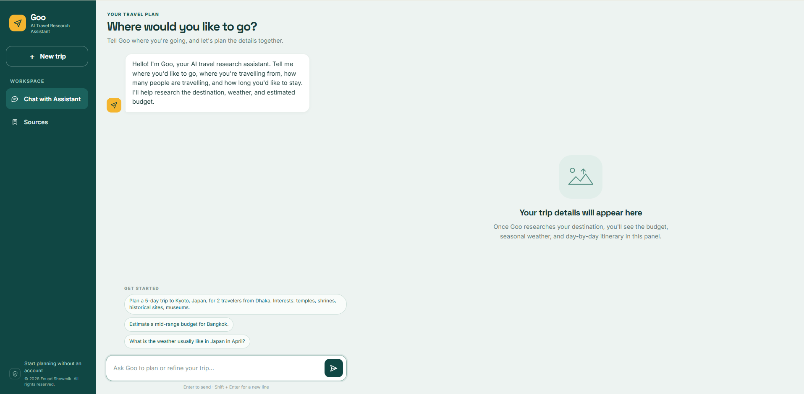
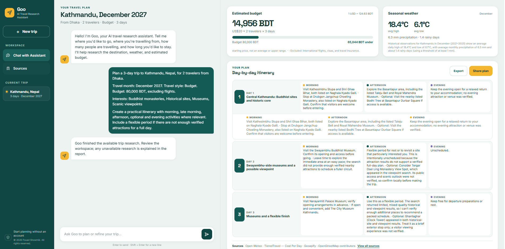
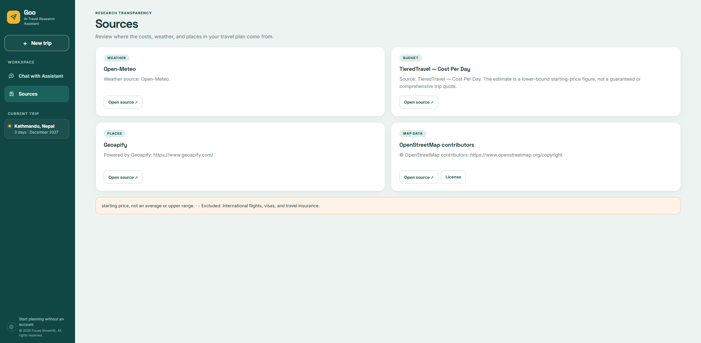
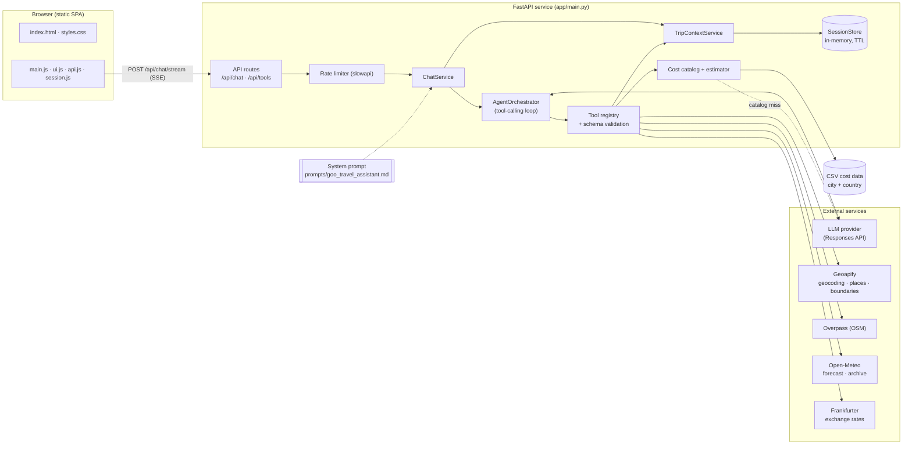
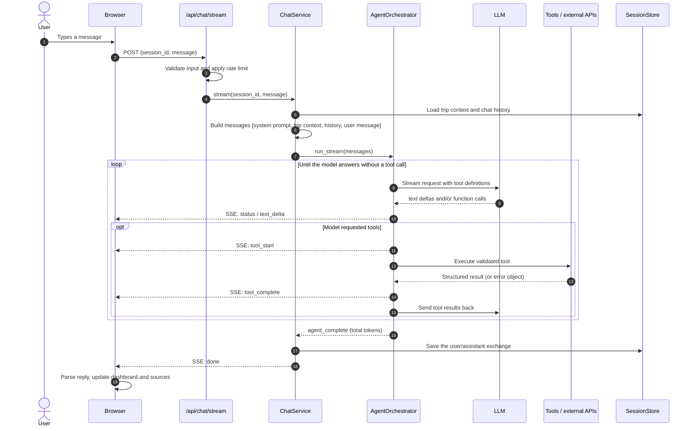
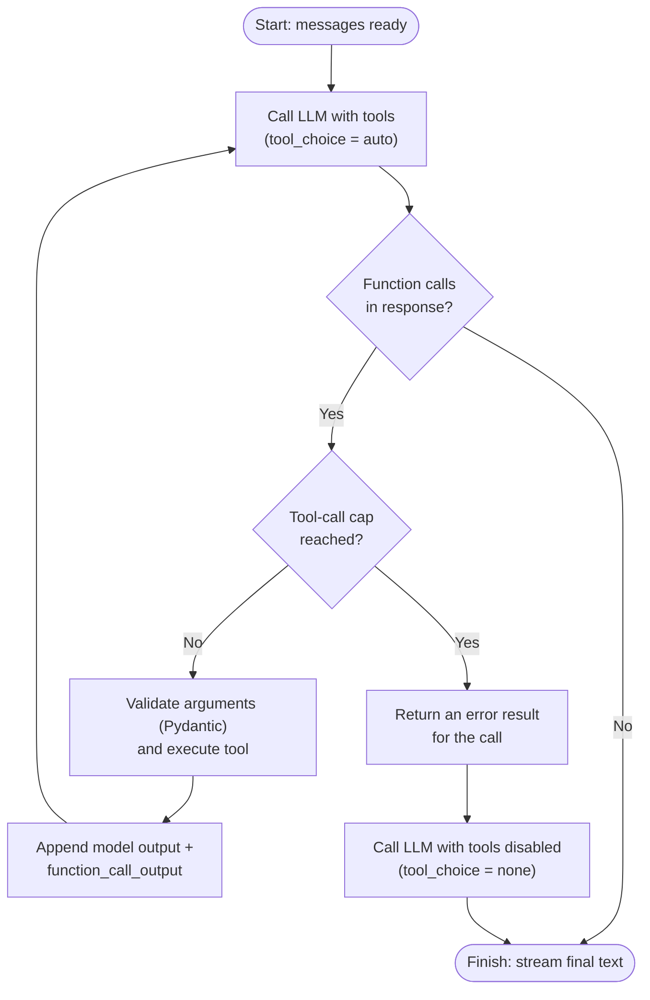
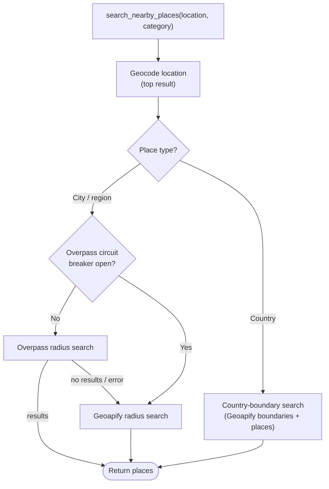
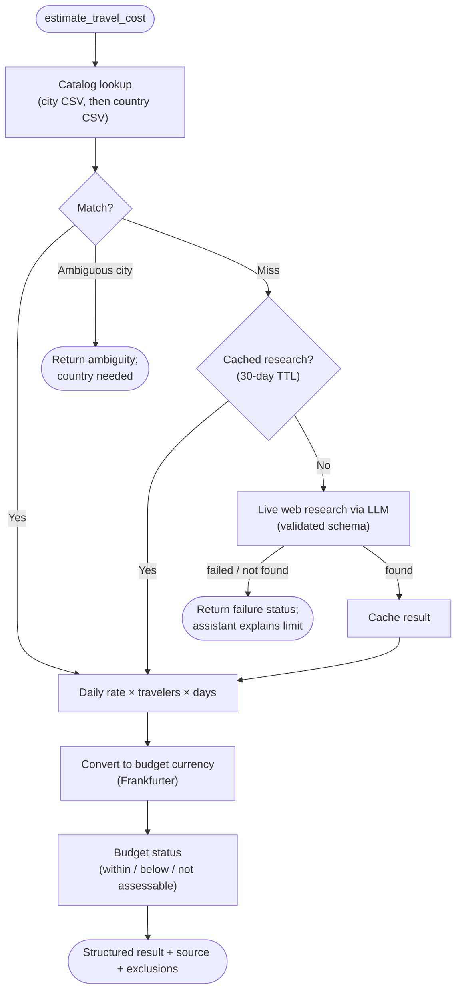

<div align="center">


# Goo — AI Travel Research Assistant

**Plan trips with an AI agent that researches before it answers.**
Destination research, seasonal weather, grounded cost estimates, and day-by-day itineraries, all in one chat.


[**Live demo**](https://goo-ai-travel-research-assistant.onrender.com)

</div>

## Preview

<p align="center">
  
  <br>
  <sub><b>Initial screen:</b> start a conversation with Goo</sub>
</p>

<p align="center">
  
  <br>
  <sub><b>Trip report:</b> budget, weather and day-by-day itinerary</sub>
</p>

<p align="center">
  
  <br>
  <sub><b>Sources:</b> data providers, links and licences</sub>
</p>

---

---

## Table of contents

1. [Overview](#1-overview)
2. [Key features](#2-key-features)
3. [System architecture](#3-system-architecture)
4. [Request workflow](#4-request-workflow)
5. [The agent loop](#5-the-agent-loop)
6. [Agent tools](#6-agent-tools)
7. [Cost estimation pipeline](#7-cost-estimation-pipeline)
8. [Trip context and session memory](#8-trip-context-and-session-memory)
9. [Frontend](#9-frontend)
10. [API reference](#10-api-reference)
11. [Project structure](#11-project-structure)
12. [Getting started](#12-getting-started)
13. [Configuration](#13-configuration)
14. [Data sources and attribution](#14-data-sources-and-attribution)
15. [Design decisions and guardrails](#15-design-decisions-and-guardrails)
16. [Known limitations](#16-known-limitations)
17. [Troubleshooting](#17-troubleshooting)
18. [License](#18-license)

---

## 1. Overview

Goo is a travel-research chat application. You tell it where you are going, and it works with an LLM that can call real tools: geocoding and place search, weather, currency conversion, and a travel-cost estimator. It then assembles the answer into a structured plan.

The central design rule is **no invented facts**. The assistant is instructed to name only places returned by its tools, to quote costs only from the estimator, and to say plainly when research failed or is incomplete. The UI then turns the reply into a trip dashboard: budget card, seasonal weather card, itinerary, and a sources page.

**What Goo does not do:** book flights, hotels or tours; check live prices; give visa or eligibility advice. It is a research and planning assistant.

---

## 2. Key features

| Area | What you get |
|---|---|
| **Agentic chat** | An LLM that decides which tools to call, loops over results, and writes the final answer. |
| **Streaming UI** | Server-Sent Events stream status updates ("Researching attractions…") and text as it is generated. |
| **Trip memory** | Structured requirements (origin, destination, travelers, days, budget, style, month, interests) saved per session and re-injected on every turn. |
| **Grounded places** | City, region, and whole-country attraction search via Geoapify and OpenStreetMap (Overpass), with automatic fallback. |
| **Weather** | 1–7 day forecasts and seasonal climate built from five years of historical data (Open-Meteo). |
| **Cost estimates** | Local CSV catalog first, then validated live web research; budget comparison with currency conversion. |
| **Dashboard** | Budget, weather, day-by-day itinerary, and a Sources page with licences and links. |
| **Export and share** | Print-to-PDF export and the Web Share API. |
| **Responsive** | Desktop, tablet, and phone layouts. |
| **Safe by default** | Input validation, per-IP rate limiting, no secrets in the browser, no API keys in logs. |

---

## 3. System architecture

Goo is a single FastAPI service that serves both the JSON/SSE API and the static frontend. There is no database and no build step.



### Layers

| Layer | Responsibility | Location |
|---|---|---|
| **Presentation** | Chat UI, dashboard, sources page, PDF export | `app/static/` |
| **API** | HTTP routes, request validation, rate limiting, SSE framing | `app/api/`, `app/schemas/`, `app/core/limiter.py` |
| **Services** | Chat flow, trip context, session memory, cost catalog and estimator | `app/services/` |
| **Agent** | Tool-calling loop, tool schemas, tool registry | `app/agent/` |
| **Tools** | Thin functions the LLM can call | `app/tools/` |
| **Clients** | HTTP wrappers for external APIs | `app/clients/` |
| **Data and prompt** | Cost CSVs and the assistant's system prompt | `app/data/`, `prompts/` |

---

## 4. Request workflow

What happens when you press **Send**:



**Step by step**

1. **Session.** The browser creates a UUID in `sessionStorage` (one conversation per tab). "New trip" deletes server memory and creates a new ID.
2. **Validation.** `ChatRequest` enforces a session-ID pattern and a 1–4000 character message.
3. **Context injection.** `ChatService` reads the saved trip requirements and builds the message list. The saved context is marked as *data, not instructions*.
4. **Agent loop.** The orchestrator streams from the LLM, runs any requested tools, feeds results back, and repeats.
5. **Persistence.** After the stream completes, the exchange is stored in the session.
6. **Rendering.** The frontend renders Markdown as text arrives, then parses the finished reply into dashboard cards, itinerary days, and sources.

---

## 5. The agent loop



Key behaviours:

- **One tool at a time.** `parallel_tool_calls` is off, so each call can use the results of the previous one.
- **Hard cap.** `MAX_TOOL_CALLS` in `app/agent/orchestrator.py` limits tool executions per request. When it is reached, tools are disabled and the model must answer with what it has.
- **Failures are data.** If a tool raises, the model receives a generic error object that tells it to explain the failure without inventing data. Internal details are logged server-side, never sent to the client.
- **Matching outputs.** Every function call receives a matching output, including calls rejected by the cap, which keeps the conversation protocol valid.

---

## 6. Agent tools

Tools are declared in `app/agent/tool_definitions.py` (JSON schema shown to the model), validated by Pydantic models in `app/schemas/`, and dispatched through `app/agent/tool_registry.py`. The model can only run functions that are registered.

| Tool | Purpose | Backed by |
|---|---|---|
| `update_trip_requirements` | Save or correct trip details (origin, destination, travelers, days, budget, currency, style, month, interests). `null` never overwrites saved values. | `TripContextService` |
| `search_destination` | Identify or disambiguate a place. | Geoapify geocoding |
| `search_nearby_places` | Find attractions by category around a city or region, or across a whole country. | Overpass → Geoapify fallback |
| `get_weather` | Forecast for 1–7 days. | Open-Meteo |
| `get_seasonal_climate` | Typical monthly weather from the previous five complete years. | Open-Meteo archive |
| `convert_currency` | Currency conversion. | Frankfurter |
| `estimate_travel_cost` | Land-trip estimate and budget comparison. | CSV catalog → live research fallback |

**Place categories:** `all_attractions`, `attraction`, `museum`, `viewpoint`, `historical_site`, `religious_site`, `gallery`, `artwork`, `park`, `beach`, `waterfall`, `picnic_site`, `camp_site`, `zoo`, `aquarium`, `theme_park`, `restaurant`, `cafe`, `hotel`.

### Place-search strategy



- Overpass timeouts open a **circuit breaker for 120 seconds**, during which Geoapify is used directly.
- Geocoding and nearby results are cached in memory.
- Results are a **nearby sample, not an exhaustive list**, so the assistant is instructed to say so.

---

## 7. Cost estimation pipeline

Costs are computed by deterministic code, not by the LLM. The model only passes parameters and explains the returned result.



- **Tiers:** `budget`, `mid_range`, `luxury`. If the user has not chosen a style, the estimator defaults to `mid_range` and the assistant must disclose that default.
- **Price basis matters.** Some sources publish a *starting price* (lower bound) and others a *recorded average*. A budget that covers a lower bound is reported as "not confirmed", never as "sufficient".
- **Flights are excluded.** If the user's budget includes flights, the result says the full budget cannot be assessed without an airfare estimate.
- **Inclusions are not double-counted.** Daily rates already include accommodation, food, local transport and activities as described by the source.
- **Saved style is applied automatically.** The tool registry fills `price_tier` from the saved trip when the model leaves it empty.

---

## 8. Trip context and session memory

**Trip requirements** (`app/schemas/trip.py`) are a validated Pydantic model:

`origin`, `destination`, `travelers`, `duration_days`, `budget_amount`, `budget_currency`, `budget_includes_flights`, `travel_style`, `travel_date`, `travel_month`, `interests`, `accommodation_preference`

- **Required before planning:** origin, destination, travelers, duration.
- **Required for budget comparison:** budget amount and currency.
- **Optional:** month/date, interests, accommodation preference, style.

On every request the saved requirements, plus lists of missing fields, are injected into the conversation as a `developer` message so the model never has to ask again for something it already knows.

**Session store** (`app/services/session_store.py`):

- In-memory dictionary guarded by a lock (requests run in parallel threads).
- Keeps the **first N** exchanges permanently and a rolling window of the **most recent N**, to bound prompt size.
- Sessions expire after `SESSION_TTL_SECONDS` of inactivity.
- **Lost on restart.** See [Known limitations](#16-known-limitations).

---

## 9. Frontend

A dependency-free single-page app in `app/static/`. It uses ES modules and needs no build tooling.

| File | Role |
|---|---|
| `index.html` | Layout: sidebar, chat panel, trip dashboard, sources view |
| `css/styles.css` | Design tokens, layouts, responsive rules (≥1280, ≤1280, ≤1050, ≤700 px), print styles |
| `js/main.js` | App state, reply parsing, dashboard updates, export/share |
| `js/ui.js` | DOM rendering: chat bubbles, Markdown, dashboard, sources |
| `js/api.js` | `fetch` + stream reader for SSE, error handling |
| `js/session.js` | Per-tab session ID |

**How the dashboard is built:** the assistant's reply follows the format in the system prompt (stable labels such as **Origin**, **Destination**, **Your budget**, and `### Day N — Title` with Morning/Afternoon/Evening bullets). `main.js` parses those labels into the budget card, weather card, itinerary, and sources list. This is why the prompt tells the model to keep those labels consistent.

**Other behaviour**

- Markdown is rendered safely in the browser as text streams in.
- **Export** switches the page to a print layout and calls `window.print()` for a PDF of the plan.
- **Share** uses the Web Share API where available.
- Responsive: on phones the sidebar becomes a top bar, the current-trip card appears as a compact strip, and the copyright footer moves to the bottom of the page.

---

## 10. API reference

Interactive docs (Swagger UI) are available at `http://127.0.0.1:8000/docs` while the server is running.

### Chat

| Method | Path | Description | Limit |
|---|---|---|---|
| `POST` | `/api/chat` | Non-streaming chat. Returns `{ reply, total_tokens }`. | 10/min, 100/day per IP |
| `POST` | `/api/chat/stream` | Streaming chat over Server-Sent Events. | 10/min, 100/day per IP |
| `DELETE` | `/api/chat/{session_id}` | Clear a session's memory and trip context. Returns `204`. | — |

**Request body**

```json
{
  "session_id": "3f1c2c52-0c4e-4d6b-9a0e-1f6b8e7c9a10",
  "message": "Plan a 5-day trip to Kyoto, Japan, for 2 travelers from Dhaka."
}
```

`session_id` must match `^[A-Za-z0-9-]{8,64}$`; `message` is 1–4000 characters.

**SSE events** (`/api/chat/stream`)

| Event | Payload | Meaning |
|---|---|---|
| `status` | `{ message }` | Progress text, such as "Reviewing research results" |
| `tool_start` | `{ name, step }` | A tool began running |
| `tool_complete` | `{ name, step }` | A tool finished |
| `text_delta` | `{ delta }` | A chunk of the assistant's reply |
| `done` | `{ total_tokens }` | The reply is complete and saved |
| `error` | `{ message }` | A safe, user-facing error message |

### Direct tool endpoints

Handy for testing the tools without the LLM. Each is limited to 10 requests per minute per IP.

| Method | Path | Tool |
|---|---|---|
| `POST` | `/api/tools/weather` | `get_weather` |
| `POST` | `/api/tools/seasonal-climate` | `get_seasonal_climate` |
| `POST` | `/api/tools/currency` | `convert_currency` |
| `POST` | `/api/tools/places` | `search_destination` |
| `POST` | `/api/tools/nearby-places` | `search_nearby_places` |
| `POST` | `/api/tools/travel-cost` | `estimate_travel_cost` |

### Health

| Method | Path | Description |
|---|---|---|
| `GET`, `HEAD` | `/health` | Returns `{"status": "ok"}` |

---

## 11. Project structure

```
Goo/
├── app/
│   ├── main.py                     # FastAPI app, routers, rate-limit handler, static mount
│   ├── agent/
│   │   ├── orchestrator.py         # Tool-calling loop (sync + streaming)
│   │   ├── tool_definitions.py     # JSON schemas shown to the LLM
│   │   └── tool_registry.py        # Name → function map, validation, saved-context defaults
│   ├── api/routes/
│   │   ├── chat.py                 # /api/chat, /api/chat/stream, DELETE session
│   │   └── tools.py                # /api/tools/* direct endpoints
│   ├── clients/                    # External API wrappers
│   │   ├── llm_client.py           # Responses API client + streaming + cost research
│   │   ├── places_client.py        # Geoapify, Overpass, Nominatim, caching, circuit breaker
│   │   ├── weather_client.py       # Open-Meteo forecast + historical archive
│   │   ├── currency_client.py      # Frankfurter rates (cached)
│   │   └── errors.py
│   ├── core/
│   │   ├── config.py               # Settings from environment / .env
│   │   └── limiter.py              # Per-IP rate limiter
│   ├── data/
│   │   ├── city_travel_costs.csv
│   │   └── country_travel_costs.csv
│   ├── schemas/                    # Pydantic models (chat, trip, tools, cost research)
│   ├── services/
│   │   ├── chat_service.py         # Builds prompts, runs orchestrator, saves history
│   │   ├── session_store.py        # In-memory sessions with TTL
│   │   ├── trip_context.py         # Required / budget field logic
│   │   ├── destination_cost_catalog.py
│   │   └── destination_cost_estimator.py
│   ├── tools/                      # Functions exposed to the model
│   └── static/                     # Frontend (HTML, CSS, JS, SVG mark)
├── prompts/
│   └── goo_travel_assistant.md     # System prompt (behaviour, rules, output format)
├── requirements.txt
├── LICENSE
└── README.md
```

---

## 12. Getting started

### Prerequisites

- **Python 3.12 or newer**
- An **LLM API key** for a provider that exposes an OpenAI-compatible **Responses API** (`POST {LLM_BASE_URL}/responses`) with function calling and streaming
- A **Geoapify API key** ([free tier available](https://www.geoapify.com/))

Open-Meteo, Frankfurter, and the OpenStreetMap services need no key.

### Installation

```bash
# 1. Clone
git clone <your-repository-url>
cd Goo

# 2. Create and activate a virtual environment
python -m venv .venv
source .venv/bin/activate          # macOS / Linux
.venv\Scripts\Activate.ps1         # Windows PowerShell

# 3. Install dependencies
pip install -r requirements.txt

# 4. Configure environment variables (see the next section)
cp .env.example .env               # then edit .env
```

### Run

```bash
uvicorn app.main:app --reload
```

Open <http://127.0.0.1:8000>. Run the command from the project root (the folder containing `app/`), since the system prompt path and `.env` are resolved relative to it.

---

## 13. Configuration

Settings are read from environment variables or a `.env` file in the project root. `.env` is git-ignored; never commit real keys.

```env
# LLM provider (OpenAI-compatible Responses API)
LLM_BASE_URL=https://api.example.com/v1
LLM_API_KEY=your-llm-api-key
MODEL_NAME=your-model-name

# Prompt
SYSTEM_PROMPT_FILE=prompts/goo_travel_assistant.md

# Conversation memory
HISTORY_FIRST_EXCHANGES=4
HISTORY_RECENT_EXCHANGES=6
SESSION_TTL_SECONDS=3600

# Places and geocoding
GEOAPIFY_API_KEY=your-geoapify-key
```

| Variable | Required | Description |
|---|---|---|
| `LLM_BASE_URL` | Yes | Base URL of the provider. Requests go to `{LLM_BASE_URL}/responses`. |
| `LLM_API_KEY` | Yes | Bearer token for the provider. |
| `MODEL_NAME` | Yes | Model identifier sent with each request. |
| `SYSTEM_PROMPT_FILE` | No | Path to the system prompt. Default: `prompts/goo_travel_assistant.md`. |
| `HISTORY_FIRST_EXCHANGES` | No | Number of earliest exchanges always kept in context. Default: `4`. |
| `HISTORY_RECENT_EXCHANGES` | No | Size of the rolling window of latest exchanges. Default: `6`. |
| `SESSION_TTL_SECONDS` | Yes | Inactivity time before a session is discarded. |
| `GEOAPIFY_API_KEY` | Yes | Key for geocoding, boundaries and places. |

### Tunable constants

| Constant | File | Effect |
|---|---|---|
| `MAX_TOOL_CALLS` | `app/agent/orchestrator.py` | Maximum tool executions per request |
| `OVERPASS_URL`, `OVERPASS_TIMEOUT`, `OVERPASS_COOLDOWN_SECONDS` | `app/clients/places_client.py` | Overpass endpoint, timeouts, circuit-breaker duration |
| `CACHE_TTL_SECONDS` | `app/tools/travel_cost.py` | Lifetime of cached web-researched costs (default 30 days) |
| `CACHE_TTL_SECONDS` | `app/clients/currency_client.py` | Exchange-rate cache (default 12 hours) |
| Rate-limit decorators | `app/api/routes/*.py` | Per-IP request limits |

### Customising behaviour

The assistant's rules, research workflow, and output format live in [`prompts/goo_travel_assistant.md`](prompts/goo_travel_assistant.md). Most behaviour changes (which tools to prefer, how many searches per category, how itineraries are formatted) are prompt edits, not code changes. If you change the labelled output format, keep it in sync with the parsing in `app/static/js/main.js`.

---

## 14. Data sources and attribution

| Source | Used for | Notes |
|---|---|---|
| [Geoapify](https://www.geoapify.com/) | Geocoding, country boundaries, place search | Powered by Geoapify |
| [OpenStreetMap](https://www.openstreetmap.org/copyright) via Overpass | Attractions and place data | © OpenStreetMap contributors (ODbL) |
| [Open-Meteo](https://open-meteo.com/) | Weather forecasts and historical climate | Attribution required when shown |
| [Frankfurter](https://frankfurter.dev/) | Reference exchange rates | Reference rates, not transaction rates |
| Guidese Trip Cost Index 2026 | Country-level daily costs (CSV) | CC BY 4.0 |
| TieredTravel "Travel Cost Per Day" | City-level daily costs (CSV) | Attribution link required; figures are starting prices |
| Live web research (via the LLM) | Costs for destinations missing from the catalog | Validated against a schema and cached |

The assistant is instructed to include Geoapify, OpenStreetMap and Open-Meteo attribution in its answers, and the **Sources** page shows each source with its link and licence.

> Always review the licence of any dataset before redistributing or commercialising it.

---

## 15. Design decisions and guardrails

| Decision | Reason |
|---|---|
| **Tools over model memory** | Places, weather, rates and costs come from tool results, which reduces made-up details. |
| **Deterministic cost maths** | The estimator computes totals; the model cannot do its own arithmetic or exchange rates. |
| **Strict argument validation** | Tool arguments pass through Pydantic schemas before any function runs. |
| **Registered tools only** | The model can only call functions listed in the registry. |
| **Saved context as data** | Saved trip details are labelled as user data, not instructions, to reduce prompt-injection risk. |
| **Tool-call cap** | Bounds latency and cost per request. |
| **Graceful degradation** | Overpass fails over to Geoapify; failed research is reported, never hidden. |
| **Safe errors** | Clients receive generic messages; details are logged server-side, and URLs containing API keys are never logged. |
| **Input limits** | Session ID pattern, message length, and per-IP rate limits on every public endpoint. |
| **Scope enforcement** | The system prompt keeps Goo on travel topics. |

---

## 16. Known limitations

- **Sessions are in memory.** Restarting the server clears all conversations and trip context. A multi-worker deployment would not share sessions, so use a single worker or move the store to Redis or a database.
- **Place results are a sample.** Searches return the nearest named places within a radius (maximum 10 km), not a ranked list of top attractions. Famous sights outside the radius may not appear.
- **Place names can be local-language.** Fallback results from Geoapify may return names in the local script.
- **Cost figures are estimates.** Some city rates are published *starting prices*, and flights, visas and insurance are excluded.
- **No live prices or bookings.** Flights, hotels and tours are out of scope.
- **Public data services can be slow.** The Overpass mirror may time out; Goo then falls back to Geoapify.
- **Itineraries reflect available data.** The assistant is told not to invent attractions, so sparse data leads to flexible or "unscheduled" slots.
- **The dashboard depends on reply format.** If the model deviates from the labelled format, some cards may show fewer details.

---

## 17. Troubleshooting

| Symptom | Likely cause and fix |
|---|---|
| `ValidationError` on startup | A required variable is missing in `.env`. Check the table in [Configuration](#13-configuration). |
| "Sorry, I'm having trouble right now" | The LLM provider returned an error or timed out. Check `LLM_BASE_URL`, `LLM_API_KEY`, `MODEL_NAME`, and the server log. |
| Garbled characters (`’`) in replies | The provider's stream was decoded with the wrong charset. In `llm_client.py`, set `response.encoding = "utf-8"` after `raise_for_status()` in the streaming method. |
| Itinerary looks thin or says data is incomplete | Place search returned few results. Add interests to your request, or use "City, Country". Check the log for Overpass timeouts. |
| `Overpass request failed ... 504` | The Overpass mirror is down or slow. Goo falls back to Geoapify automatically. You can change `OVERPASS_URL`. |
| "You're sending messages too fast" (HTTP 429) | The per-IP rate limit was hit. Wait a minute. |
| Trip details vanish after a restart | Expected, since sessions are in memory. |
| `ModuleNotFoundError: app` | Run commands from the project root, the folder that contains `app/`. |

---

## 18. License

Released under the **MIT License**. See [LICENSE](LICENSE) for details.

© 2026 Mutasim Fouad Showmik